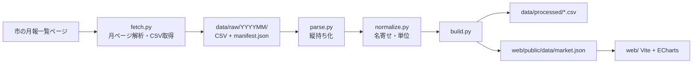

# 設計メモ

仕様の正本は [SPEC.md](SPEC.md)。ここでは実装済みの P0 の設計と、P1 以降の設計方針を簡潔にまとめる。

## 1. 全体構成



## 2. ディレクトリ

```
etl/
  common.py       定数・正規化・文字コード判定
  fetch.py        取得（P0 実装済み）
  parse.py        CSV -> 縦持ち（P1）
  normalize.py    名寄せ（P1）
  build.py        出力（P1）
  config/aliases.yml
data/raw/YYYYMM/  {R,T,V}{11,12}.csv, manifest.json
data/raw/index.json, report.md, report.json
data/processed/   items.csv, origins.csv, others.csv（P1）
web/              フロント（P2）
tests/
docs/
```

リポジトリルートは `market/`（仕様書の `market-race/` に相当）。

## 3. fetch.py の設計（実装済み）

### 3.1 処理の流れ

1. 一覧ページを取得し、`「YYYY年M月分」+「月報」` を含むリンクを月ごとに抽出する。
   年月はリンク文言（NFKC 正規化・空白除去後）から取る。URL は使わない。
2. 月ごとに月ページを取得し、`h2「各種データ」` 以降、次の `h2` までを走査する。
   - `h3`（青果部／水産物部／花き部）で現在の部門を切り替える。
   - `.csv` リンクのうち、リンク文言に「品目別取扱高順位表」「産地別取扱高順位表」を含むものを採用する。
3. CSV を `data/raw/YYYYMM/{部門}{11|12}.csv` として **バイト列のまま** 保存する。
   元のファイル名・URL・サイズ・警告は `manifest.json` に記録する。
4. 全月の保存結果から `report.md` / `report.json` を作る（取得有無に関わらず `data/raw` から再集計）。

### 3.2 設計判断

| 項目 | 判断 |
|---|---|
| 識別の主キー | 部門見出し + リンク文言。ファイル名の正規表現は副次チェック（警告のみ） |
| 花き部が無い月 | エラーにしない。見出しが無ければ部門ごと無し |
| キャッシュ | `manifest.json` が `ok` かつ CSV が揃っていれば再取得しない（`--force` で上書き） |
| レート | 1 秒以上の間隔、リトライ 3 回（待機 2 秒、4 秒） |
| 失敗時 | その月は `manifest.json` を作らず失敗として記録、続行。最後に終了コード 1 |
| HTML 混入 | 先頭が `<` なら CSV ではないとして失敗扱い |
| TLS | OS の CA ストアがあれば使用。`REQUESTS_CA_BUNDLE` 指定を優先。検証は無効化しない |

### 3.3 レポートで検査する項目

- 一覧のリンク数、取得月数、未取得、一覧内の欠損月
- 部門ごとの開始月・終了月・月数
- 大品目の一覧、数量の単位（列名から）、文字コード（`utf-8-sig` / `cp932`）
- ファイル名が既知パターンに一致しない月
- 列名の不一致・表記ゆれ（注記［…］は無視して比較）、単位なし
- CSV 内の年月と一覧の年月の不一致
- 想定外の大品目、順位行数が 20 でない、順位が 20 を超える、「その他」が 1 行でない

## 4. CSV の構造（確認済み）

- 品目別（`*11`）: `大品目,年［西暦］,月,品目,順位,数量合計［単位］,数量合計比率［％］,金額合計［円］,金額合計比率［％］,主要産地`
- 産地別（`*12`）: `大品目,年［西暦］,月,順位,原産地,数量合計［単位］,...,主要品目`
- 1 ファイルに大品目が縦に並び、各大品目は順位 1〜20 の後に「その他」1 行。
- 「その他」行は大品目・年・月・順位が空（2024-08 R12 のみ順位列に「その他」が入る列ずれ）。
- 順位は数量の降順（金額順ではない）。

不規則な点は [HANDOVER.md](HANDOVER.md) の 3 章を参照。

## 5. P1 の設計（実装済み）

### 5.1 parse.py

- 入力は `data/raw/YYYYMM/manifest.json` と CSV。`decode_csv` で読み、エンコーディングを記録する。
- 列は列名の基本名（末尾の［…］を除いたもの）で位置を決める。基本名が想定と違えば `ParseError`。
- 行の分類: 順位が数字なら通常行（21 位以上は除外）、それ以外で内容のある行は「その他」行（`others.csv`）。
  「その他」行の列ずれ（順位の列に「その他」）や、大品目・年月が入っている場合も同じ扱い。
- 大品目は空欄なら直前の値を引き継ぐ。大品目は `category_aliases` で正規化し、部門の想定集合に無ければ
  その行は取り込まず `EXCLUDED_CATEGORY`（欠測）として記録する。
- 数量の単位は列名から（`㎏` は NFKC で `kg`）。無ければ部門で補い `UNIT_ASSUMED` を記録する。
- `主要産地`/`主要品目` は `、` と `・` で分割して JSON 配列として保存する。
- 年月は CSV の列から取り、一覧の月と一致しなければ `ParseError`。数値が読めない、順位が連番でない場合も `ParseError`。
- 吸収した例外は `Issue(code, year_month, file, message, excluded)` に集める。
  コード: `CATEGORY_ALIAS` / `EXCLUDED_CATEGORY` / `UNIT_ASSUMED` / `RANK_TRUNCATED` / `FEWER_THAN_20` / `NO_OTHER_ROW` / `MULTIPLE_OTHER_ROWS` / `ENCODING_FALLBACK`

### 5.2 normalize.py と aliases.yml

- キーは NFKC＋空白除去。同じキーは自動で統合し、表示名は最新月の表記に揃える。
- 同じ月・大品目・種別でキーが重複したら `ParseError`（人が `aliases.yml` で決める）。
- `aliases.yml`: `category_aliases`（部門 -> 別名）と `name_aliases`（items/origins -> 大品目 -> 旧名: 新名）。
  品目の統合ルールは初期は空。
- 統合候補: 同じ大品目・種別の中で、部分一致または文字列類似度 0.8 以上のペアを `merge_candidates.csv` に出す。
  `never_together`（同月に共存しない）は改名・分類移動の可能性が高い。「その他」単独との一致は除く。

### 5.3 build.py の出力

- `data/processed/items.csv` / `origins.csv`: 仕様 5.3 のスキーマ。`related` は JSON 配列文字列。
- `others.csv`: `year_month, category, kind, qty, amt, qty_ratio, amt_ratio`（欠けた値は空欄）。
- `report.md`: 件数・文字コード・例外一覧。`merge_candidates.csv`: 統合候補。
- `web/public/data/market.json`: 仕様 5.5 に加え `meta.categories[].first_month` と `meta.missing` を持つ。
  - 配列は `meta.months`（一覧の月、44）と同じ長さ。圏外・データ無しは `null`。
  - `meta.missing`: 取り込めなかった月（部門・種別単位で、その部門の全大品目に付く）。
  - 品目は期間中の数量合計の降順。

### 5.4 テスト

- `tests/test_etl_unit.py`: 合成データでの parse / normalize / build の挙動と、CSV 二重エスケープの回帰（生テキストで確認）。
- `tests/test_data.py`: 実データでの SPEC 7.1 / 7.2。既知の元データ不具合は `EXPECTED_ISSUES` と
  `RATIO_EXCEPTIONS` に明示し、過不足があれば落ちる（元データの変化を検知する）。

## 6. フロントの設計方針（P2 以降）

- Vite + TypeScript + ECharts 5。`market.json` を fetch する静的サイト。
- 描画は仕様 6.2 に従う（`realtimeSort`、`valueAnimation`、カテゴリ軸は `inverse: true`）。
- 状態: 大品目、軸（品目/産地）、指標（数量/金額）、表示件数（10/20）、再生中、月インデックス、速度。
- 金額モードは「数量上位 20 位の中での金額順」の注記を常時表示する。
- 花きは 2025-11 以降のみデータがあるため、期間外は開始月から再生する。
- クレジット（CC-BY 2.1 日本、市が作成・保証したものではない旨）を常時表示する。

## 7. 運用（P4）

- GitHub Actions で毎月 20 日頃に実行し、未取得月だけ取得 -> ETL -> ビルド -> GitHub Pages へデプロイ。
- 取得失敗はジョブを失敗させる（`fetch.py` は失敗時に終了コード 1）。
- `data/raw` をリポジトリで保持するか、Actions のキャッシュにするかは未決。
